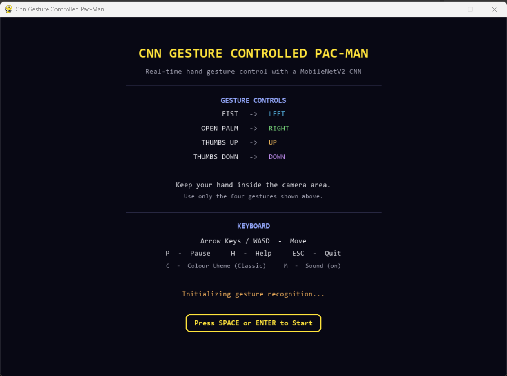
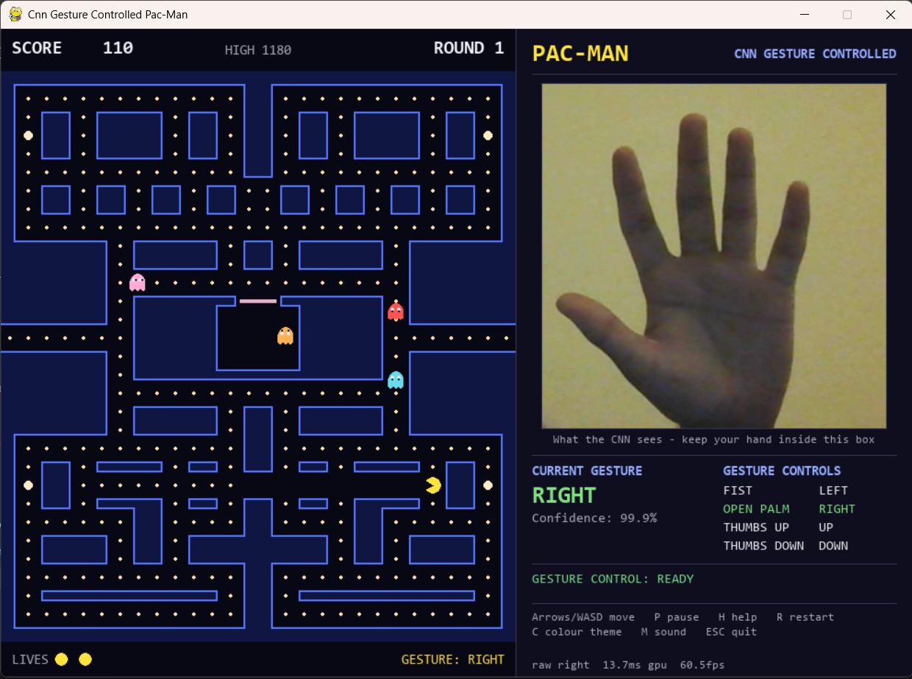
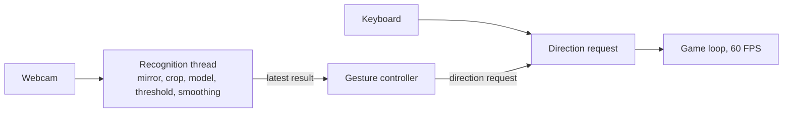
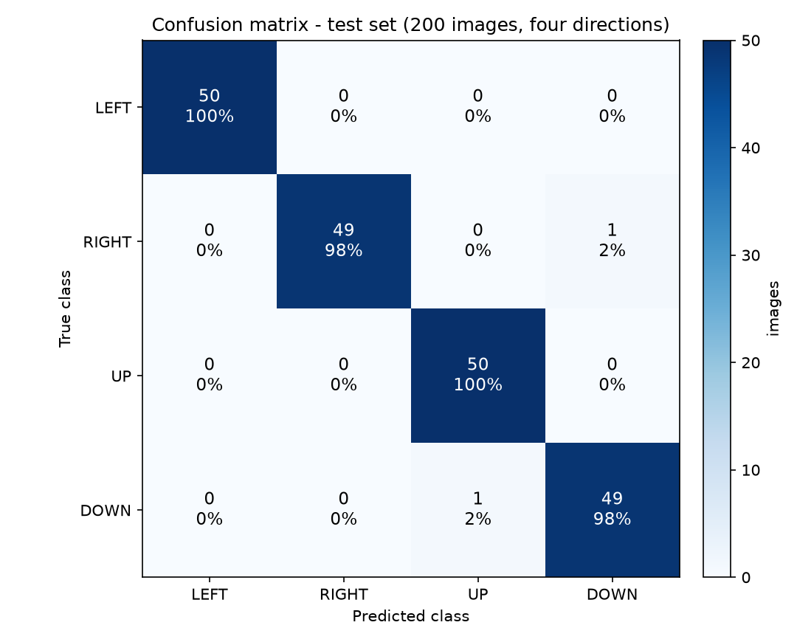
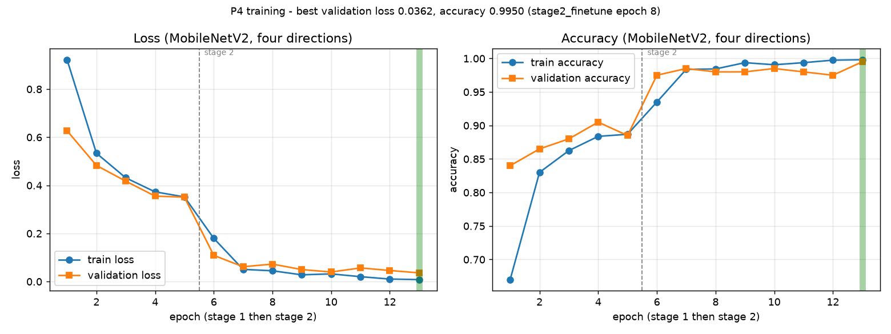

# CNN Gesture Controlled Pac-Man

[](https://github.com/TanmaySingh2711/gesture-controlled-game/actions/workflows/ci.yml)

A Pac-Man-style maze game that you steer with hand gestures in front of an ordinary webcam.

| Gesture | Pac-Man goes |
|---|---|
| Closed fist | LEFT |
| Open palm | RIGHT |
| Thumbs up | UP |
| Thumbs down | DOWN |

## Preview

The start screen explains the gestures and keys while the model loads in the background.



During play, the panel on the right shows exactly what the model sees, the command that is
steering Pac-Man (here an open palm, so RIGHT, at 99.9% confidence) and the four gestures.



## Table of Contents

- [Quick Start](#quick-start)
- [Overview](#overview)
- [Problem Statement](#problem-statement)
- [Objectives](#objectives)
- [Key Features](#key-features)
- [Tech Stack](#tech-stack)
- [Architecture](#architecture)
- [How It Works](#how-it-works)
- [Project Structure](#project-structure)
- [Requirements](#requirements)
- [Installation](#installation)
- [Configuration](#configuration)
- [How to Run](#how-to-run)
- [Usage](#usage)
- [Example Output](#example-output)
- [Model Details](#model-details)
- [Dataset](#dataset)
- [Results](#results)
- [Limitations](#limitations)
- [Contributing](#contributing)
- [License](#license)
- [Author](#author)
- [Acknowledgements](#acknowledgements)

## Quick Start

You need Python 3.12. A webcam is only needed for gesture control.

```bash
git clone https://github.com/TanmaySingh2711/gesture-controlled-game.git
cd gesture-controlled-game
python install.py                        # one-time setup
venv\Scripts\activate                    # Windows (elsewhere: source venv/bin/activate)
python src/play_gesture.py               # play with gestures and keyboard
```

On Windows you can skip the terminal: double-click `setup.bat` once, then `run_game.bat`.

## Overview

This is a maze game in the style of Pac-Man: you eat pellets, dodge four ghosts and clear rounds.
The difference is how you steer. A webcam watches your hand, a small neural network (a CNN)
decides which of four gestures you are showing, and the game turns that into a direction.

The keyboard works at the same time, and you can also play without a webcam. The trained model is
already in the repository, so the game works right after setup, with nothing to download or train.

## Problem Statement

Games are usually played with a keyboard, a mouse or a controller. This project tries a
different input: your bare hand in front of a normal webcam.

That sounds easy, but a few things have to go right at the same time:

- The model has to be right almost every time. One wrong reading can send Pac-Man into a ghost.
- It has to be quick. A turn that arrives late is a missed turn.
- A slow camera frame must never slow the game down.
- An empty frame or a relaxed hand must not turn Pac-Man by accident.

## Objectives

- Recognise four hand gestures from a live webcam, reliably.
- Turn those gestures into game moves with little delay.
- Keep the game at 60 frames per second while recognition runs alongside it.
- Keep it playable without an NVIDIA GPU, and without a webcam.
- Measure the results honestly, including where the model gets things wrong.

## Key Features

**The game**

- **Original maze:** a 28 x 31 maze with 330 pellets and 4 power pellets.
- **Four ghosts:** the Chaser, the Ambusher, the Flanker and the Drifter, each with its own way
  of chasing you.
- **Classic rules:** power pellets, frightened ghosts, bonus fruit, 3 lives, an extra life at
  10,000 points, and rounds that get harder.
- **Saved settings:** your high score, colour theme and sound setting are remembered.
- **Sound effects:** short sounds for pellets, ghosts and lost lives, generated by the game
  itself. Press M to mute them.

**Gesture control**

- **Four gestures:** fist, open palm, thumbs up and thumbs down.
- **Keyboard always works:** arrow keys and WASD work together with gestures.
- **Camera panel:** a large live view of the hand area shows exactly what the model sees.
- **No accidental turns:** a gesture must be at least 90% confident and win 3 of the last 5
  frames before it moves Pac-Man.
- **Camera problems handled:** if the webcam stops, the game tries to reconnect. If the camera
  is on but sends a black picture (for example, its privacy switch is off), the panel tells you.
  Either way, the keyboard keeps working.

**Other**

- **Runs without a GPU:** the model uses an NVIDIA GPU when there is one, and the CPU otherwise.
- **Colour themes:** classic, high contrast and colour-blind safe. Nothing in the game depends
  on colour alone.
- **One-command setup:** a single script creates the environment and checks that it works.
- **Safe model loading:** the model file is checked against a fixed checksum before it loads.

## Tech Stack

| Area | What is used |
|---|---|
| Language | Python 3.12 |
| Game | Pygame |
| Model | PyTorch and torchvision (MobileNetV2) |
| Camera and images | OpenCV, Pillow, NumPy |
| Evaluation and plots | scikit-learn, Matplotlib |
| Tests | pytest, pytest-cov, Hypothesis |
| Code quality | ruff, mypy, pre-commit, pip-audit |
| CI | GitHub Actions on Windows, macOS and Linux |

## Architecture



Two loops run side by side and never wait for each other. The **recognition thread** owns the
webcam and the model, and the **main thread** runs the game. They only share the latest result,
so a slow camera frame can never slow the game down.

Gestures and the keyboard both go through the same direction request, and the game code in
`game/` does not import PyTorch or OpenCV at all.

More detail: [docs/ARCHITECTURE.md](docs/ARCHITECTURE.md).

## How It Works

1. The webcam gives a 640 x 480 frame.
2. The frame is mirrored, so your hand moves on screen the way it moves in front of you.
3. A fixed 300 x 300 box is cut out of the frame. This is where you hold your hand.
4. The box is resized to 160 x 160 and passed to the model.
5. The model gives a score for each of the four gestures.
6. If the best score is below 0.90, the frame is ignored.
7. A gesture only becomes a command after it wins 3 of the last 5 frames.
8. The command goes to the game as a direction request.
9. Pac-Man takes the turn at the next spot where that turn is possible.

When there is no confident gesture, nothing happens. Pac-Man keeps going the way he was going.
He never stops on his own.

## Project Structure

```text
gesture-controlled-game/
├── install.py                # one-command setup
├── setup.bat  setup.sh       # one-click wrappers around install.py
├── run_game.bat              # double-click to play (Windows)
├── pyproject.toml            # packaging and tool settings
├── game/                     # the game itself (Pygame only, no model code)
│   ├── engine.py             # rules, rounds, drawing
│   ├── maze.py  player.py  ghost.py  entity.py  controls.py
│   ├── theme.py  audio.py  profile.py
│   └── main.py               # keyboard-only launcher and self-test
├── src/                      # gesture recognition, training and evaluation
│   ├── play_gesture.py       # the full application
│   ├── gesture_recognizer.py # model, threshold and smoothing
│   ├── game_integration.py   # recognition thread and gesture controller
│   ├── camera.py             # webcam opening and the fixed capture area
│   ├── realtime_gesture.py   # live camera preview and trial recorder
│   ├── train_model.py        # builds and trains the model
│   ├── data_pipeline.py      # dataset split, preprocessing and augmentation
│   ├── evaluate_model.py     # test-set evaluation
│   ├── crop_hagrid_hands.py  # builds the dataset from HaGRID
│   ├── environment_check.py  # checks that everything is installed correctly
│   └── check_*.py            # standalone self-test scripts
├── tests/                    # pytest suite
├── requirements/             # cuda.txt, cpu.txt, dev.txt
├── model/                    # the trained model and its training history
├── dataset/                  # split and class mapping (the images are not in git)
├── reports/                  # evaluation results and figures
├── docs/                     # deeper documentation: start with docs/README.md
└── .github/workflows/ci.yml  # CI pipeline
```

Anything the tools generate (caches, coverage files) goes into one `.cache/` folder. Git ignores
it, and it is safe to delete.

## Requirements

- **Python 3.12, 64-bit.** The setup script checks this and stops on any other version.
- **Windows, macOS or Linux.**
- **A webcam** for gesture control. Keyboard play does not need one.
- **An internet connection for setup.** With an NVIDIA GPU, the PyTorch download alone is about
  2 GB. The CPU version is much smaller.

An NVIDIA GPU is optional. Without one, the model runs on the CPU.

On a minimal Linux install, OpenCV also needs one system package:

```bash
sudo apt-get install libgl1
```

## Installation

Clone the repository:

```bash
git clone https://github.com/TanmaySingh2711/gesture-controlled-game.git
cd gesture-controlled-game
```

Then run the setup in whichever way suits you.

**Windows, without a terminal:** double-click `setup.bat`.

**macOS or Linux:**

```bash
bash setup.sh
```

**Any system, from a terminal:**

```bash
python install.py
```

All three do the same thing:

1. Create a virtual environment in `venv/`.
2. Install PyTorch with GPU support if an NVIDIA GPU is found, or the CPU version otherwise.
3. Install the other libraries and the project itself.
4. Run a check that loads the model and times it on your machine.

Useful options:

| Command | What it does |
|---|---|
| `python install.py --dev` | Also installs the test and code-quality tools |
| `python install.py --cpu` | Uses the CPU version of PyTorch even if a GPU is found |
| `python install.py --fresh` | Rebuilds `venv/` from scratch. Use it after moving the project folder |

<details>
<summary>Manual setup</summary>

```bash
python -m venv venv
venv\Scripts\activate                     # Windows (elsewhere: source venv/bin/activate)
pip install -r requirements/cuda.txt      # NVIDIA GPU. Without one: requirements/cpu.txt
pip install -e . --no-deps
python src/environment_check.py
```

</details>

## Configuration

There is nothing you have to configure. The project uses no API keys, no accounts and no `.env`
file.

**Command-line options** for `src/play_gesture.py`:

| Option | What it does |
|---|---|
| `--no-camera` | Keyboard only. The model and webcam are not loaded |
| `--device auto\|cuda\|cpu` | Where the model runs. The default is `auto` |
| `--benchmark FRAMES` | Plays for that many frames, prints a speed report and exits |
| `--threshold VALUE` | Changes the 0.90 confidence threshold, for testing |
| `--log-level LEVEL` | `DEBUG`, `INFO`, `WARNING` or `ERROR` |

**Optional environment variables:**

| Variable | What it does |
|---|---|
| `GESTURE_PACMAN_HOME` | Folder for the saved profile. The default is `~/.gesture_pacman/` |
| `GESTURE_WEBCAM_TESTS=1` | Also runs the tests that need a real webcam |

## How to Run

**Windows:** double-click `run_game.bat`. Its command window and the game window both open in
the middle of the screen, and pressing **ESC** in the game closes both.

**From a terminal**, after activating the environment
(`venv\Scripts\activate` on Windows, `source venv/bin/activate` elsewhere):

```bash
python src/play_gesture.py               # gestures and keyboard
python src/play_gesture.py --no-camera   # keyboard only
python game/main.py                      # the plain game, without the gesture panel
```

A game window opens. There is no web page or server.

## Usage

1. Start the game. The start screen shows the four gestures.
2. Wait until the camera is ready, then press **SPACE** or **ENTER**.
3. Sit about an arm's length from the webcam, in a well-lit room.
4. Hold your hand inside the large camera box on the right. It shows exactly what the model sees.
5. Show a gesture to turn. The panel shows which command is steering Pac-Man.
6. Show the gesture a moment before a junction. Pac-Man turns as soon as the turn is possible.

Stick to the four gestures. Other hand shapes can be mistaken for one of them.

**If the panel says `CAMERA: NO PICTURE`:** the webcam is on but sends a black or static
picture. Check its privacy switch or cover (on some laptops, such as MSI models, it is
**Fn + F6**) and close any other program that is using the camera. Gestures come back by
themselves when the picture returns, and the keyboard keeps working the whole time.

**Keyboard:**

| Key | Action |
|---|---|
| Arrow keys / WASD | Move |
| P | Pause |
| H or F1 | Help |
| C | Change colour theme |
| M | Sound on / off |
| R | Restart after Game Over |
| ESC | Quit |

**Scoring:** a pellet is 10 points and a power pellet 50. Ghosts eaten in a row give 200, 400,
800 and 1600, and bonus fruit is worth 100 to 5000.

## Example Output

<details>
<summary>The setup check: <code>python src/environment_check.py --skip-webcam</code> (shortened)</summary>

On a laptop with an NVIDIA RTX 3050 Ti:

```text
[PASS] Python             3.12.10
[PASS] PyTorch            version 2.14.0+cu130
[PASS] CUDA available     True (CUDA runtime 13.0, cuDNN 92400)
...
[PASS] OpenCV             version 5.0.0
[PASS] Gesture model      checksum verified, 10.8 ms per frame on cuda
[PASS] Pygame             version 2.6.1
...
RESULT: PASS (all 14 checks passed)
```

</details>

<details>
<summary>A speed report: <code>python src/play_gesture.py --benchmark 600 --device cpu</code></summary>

On the same laptop, using only the CPU:

```text
game: 600 frames | 57.5 FPS | frame p95 21.0 ms
camera: 153 frames | 26.2 FPS | CNN mean 13.70 ms | median 13.12 | p95 15.99 | reconnects 0
requests applied: 138 | snapshots published: 157 (one slot, never a queue)
camera frame -> direction request: median 22.4 ms | p95 29.1 ms (70 samples)
worker stopped cleanly: True
```

</details>

## Model Details

| | |
|---|---|
| Model | MobileNetV2 from torchvision, pretrained on ImageNet, with a new 4-way output layer |
| Size | 2,228,996 parameters, about 9 MB on disk |
| Input | A 160 x 160 colour image of the hand area |
| Output | A score for each of `left`, `right`, `up` and `down` |
| File | `model/best_direction_model.pt` |

**Training** ran in two stages on 1,600 images. First only the new output layer learned, with the
rest of the network frozen. Then the last blocks were unfrozen and fine-tuned at a lower learning
rate. The best version was picked by validation loss.

Training images were randomly flipped left to right, slightly rotated, shifted and brightened,
but never flipped upside down, because that would turn a thumbs up into a thumbs down.

**While playing**, a frame only counts if the model is at least 90% confident, and a gesture only
becomes a command if it wins 3 of the last 5 frames. Both settings came from live webcam trials,
not from the test images.

More detail: [docs/MODEL_CARD.md](docs/MODEL_CARD.md), and
[docs/MODEL_STUDY.md](docs/MODEL_STUDY.md), which compares MobileNetV2 with other networks and
finds none of them clearly better.

## Dataset

The images come from [HaGRID](https://huggingface.co/datasets/cj-mills/hagrid-sample-500k-384p),
a public hand-gesture dataset released under CC-BY-SA-4.0.

- **2,000 images**, 500 per gesture, from the HaGRID classes `fist`, `palm`, `like` and `dislike`.
- Each image is cut down to the hand using the bounding box that comes with HaGRID, with a bit of
  padding. This makes the images look like the webcam's hand area.
- **Split:** 1,600 for training, 200 for validation and 200 for testing.

The images are not stored in this repository. You only need them to retrain or re-check the
model. To rebuild them:

```bash
python src/crop_hagrid_hands.py --promote   # downloads only the images it needs
python src/check_dataset.py                 # checks the result
```

A second set of 2,000 images, from 1,727 people who are not in the dataset at all, is used to
test the model on hands it has never seen.

More detail: [docs/DATASET_CARD.md](docs/DATASET_CARD.md).

## Results

All numbers below come from files in `reports/` and `model/`, except the CPU speed, which is from
the benchmark shown in [Example Output](#example-output).

**Accuracy**

| Test | Result |
|---|---|
| Test images (200, never used in training) | 99.0% (198 of 200). 95% range: 96.4% to 99.7% |
| People the model has never seen (2,000 images) | 99.6% (1,992 of 2,000). 95% range: 99.2% to 99.8% |
| Macro F1 on the test images | 0.990 |





**Speed**

| Measure | Result |
|---|---|
| Model alone on an RTX 3050 Ti | 6.0 ms per image |
| Model on the CPU, inside the game | 13.7 ms per frame on average |
| Game and camera over a 330 second run, with the GPU | 60.1 FPS game, 30.4 FPS camera |
| Memory | about 48 MB for the game; 22 MB peak GPU memory for the model |

**Live webcam trials** (one webcam, one room)

| Trial | Result |
|---|---|
| Holding a gesture | 80 of 80 recognised |
| Empty box or relaxed hand | 0 false commands in 40 trials |
| Changing from one gesture to another | 2 of 18 changes passed through a wrong command |
| Time for a whole gesture change | median 1.3 s in one run, 2.9 s in an earlier one |

Most of that change time is the hand moving. Once the model first sees the new gesture, it takes
143 ms on average to make it a command.

<details>
<summary><b>Camera conditions</b> (simulated on the 2,000 unseen-people images)</summary>

| Condition | Accuracy |
|---|---|
| Normal | 99.6% |
| Dim light, colour casts, heavy JPEG, low resolution, tilted hand | 97.9% to 99.4% |
| Very bright light | 94.0% |
| Moderate camera noise | 94.3% |
| Strong blur | 76.7% |
| Heavy camera noise, as in a dark room | 58.6% |

</details>

**Tests:** 556 automated tests, run on every push in CI. CI fails if code coverage drops below 90%.

## Limitations

- **Only four gestures.** There is no "none of these" class, so a clear gesture outside the four,
  such as a peace sign, can be read as one of them.
- **Dark rooms cause errors.** Camera noise in low light leads to confident wrong readings, so
  play in a lit room.
- **Fast hand movement blurs the image**, and accuracy drops with strong blur.
- **Changing gestures takes about a second.** Show the next gesture a little early.
- **Fixed hand position.** Your hand has to be inside the box on the right side of the frame.
- **Live testing was small.** It used one webcam in one room.
- **macOS and Linux** are covered by automated setup and tests, but live webcam play was only
  tested on Windows.
- **Retraining needs an NVIDIA GPU** and the dataset images. Playing does not.
- **Python 3.12 only.**

## Contributing

This project is not open source (see [License](#license)), so please get in touch with the author
before you start. If you get the go-ahead:

1. Fork the repository.
2. Create a branch: `git checkout -b my-change`
3. Make your change.
4. Run the checks below.
5. Commit with a message that says what changed, for example `fix: keep the camera error visible`.
6. Push the branch and open a pull request.

Checks to run first (install the tools with `python install.py --dev`):

```bash
ruff format . && ruff check .        # formatting and lint
mypy game src tests install.py       # type check
pytest                               # all tests
pytest -m "not slow"                 # a quicker run while editing
```

Tests that need a GPU, a webcam or the dataset images skip themselves when those are missing.
[docs/CONTRIBUTING.md](docs/CONTRIBUTING.md) lists a few extra rules that protect the reported
results, such as never re-running the evaluation on the test images.

## License

Copyright (c) 2026 Tanmay Singh. All rights reserved. This is proprietary software. The code is
visible for viewing only, and you may not use, copy, modify or redistribute it without written
permission. See [LICENSE](LICENSE).

The HaGRID images used for training have their own license, CC-BY-SA-4.0. They are not part of
this repository.

## Author

**Tanmay Singh**: [@TanmaySingh2711](https://github.com/TanmaySingh2711)

## Acknowledgements

- **HaGRID** hand-gesture dataset by Kapitanov et al., used through the
  [hagrid-sample-500k-384p](https://huggingface.co/datasets/cj-mills/hagrid-sample-500k-384p)
  sample.
- **MobileNetV2** with ImageNet weights, from torchvision.
- **Pygame**, **PyTorch** and **OpenCV**.

The maze, graphics and sound effects were made for this project.
